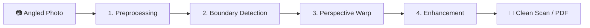
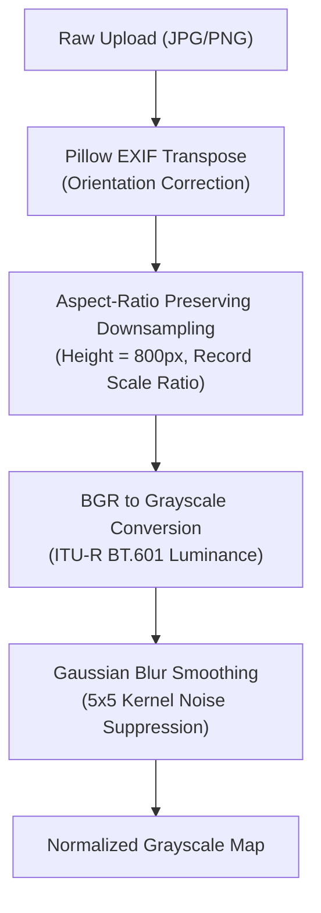
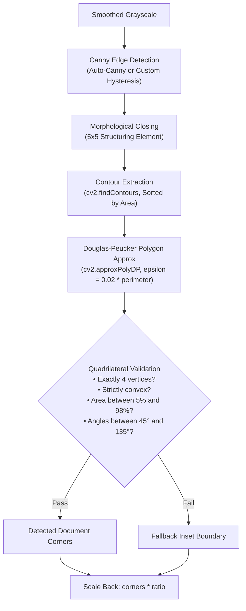
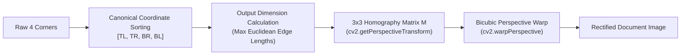
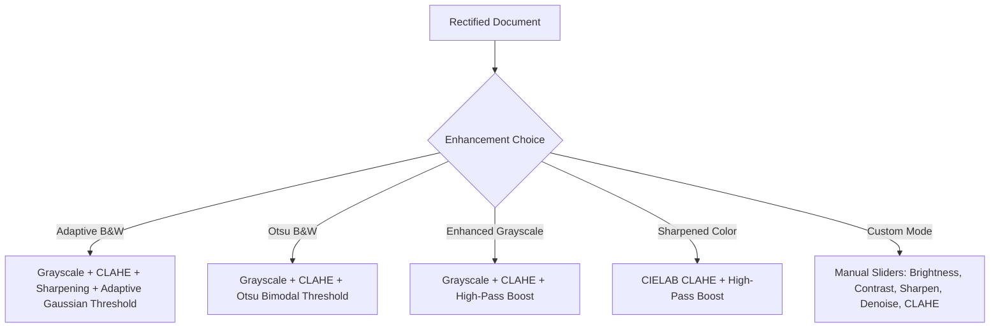

# How It Works: Technical Architecture & Pipeline Guide

This guide provides an in-depth, structured explanation of the **Smart Document Scanner & Image Enhancement System**: what technologies are used, the specific problems they solve, and how each stage of the computer vision pipeline functions step by step.

---

## 1. Executive Summary & Objective

When documents are photographed using handheld smartphones, three major distortions occur:
1. **Geometric Perspective Distortion**: Non-perpendicular camera angles turn rectangular documents into trapezoids where parallel text lines converge.
2. **Illumination Gradients & Shadows**: Uneven ambient room lighting, hand shadows, or phone glare create non-uniform backgrounds.
3. **Sensor Noise & Blur**: High camera ISO introduces salt-and-pepper grain, while lens compression can soften text strokes.

This application uses **deterministic, classical computer vision** (OpenCV, NumPy, Pillow) to detect page boundaries, rectify perspective distortion into an orthographic view, equalize lighting, sharpen text, and generate archival-quality documents.

---

## 2. Technologies & Libraries Used

| Technology | Purpose | Why It Was Chosen |
| :--- | :--- | :--- |
| **Python 3.10+** | Core Language | Broad ecosystem for scientific computing and computer vision. |
| **OpenCV (`opencv-python-headless`)** | Computer Vision Engine | Industry-standard C++ optimized image processing library. The headless build eliminates GUI window dependencies, avoiding conflicts in web and containerized environments. |
| **NumPy** | Vectorized Math | High-speed matrix operations, Euclidean distance geometry, 2D convolution kernels, and coordinate transformations. |
| **Pillow (PIL)** | Ingestion & EXIF Handling | Reads image metadata and applies EXIF orientation normalization so mobile captures aren't rotated sideways. |
| **ReportLab** | PDF Generation | Precision vector document compilation that fits scans cleanly onto A4/Letter pages while preserving true physical aspect ratios. |
| **Streamlit** | Interactive UI | Reactive single-page dashboard with session state management for live parameter tuning without vertical scrolling. |
| **Poetry** | Dependency Management | Deterministic lockfile resolution and isolated virtual environments. |
| **Pytest** | Automated Testing | Comprehensive unit and edge-case test suite (48 test cases). |

---

## 3. The 5-Stage Processing Pipeline

---

### Stage 1: Ingestion & Preprocessing
**Module**: [`src/preprocessing/`](src/preprocessing/)

Before detecting boundaries, raw camera photographs must be standardized and pre-filtered.

1. **EXIF Camera Orientation Correction**:
   - Modern smartphones do not rotate pixel matrices when holding the phone vertically; they store an EXIF orientation flag (1 to 8).
   - Standard OpenCV reads raw pixel memory, causing vertical documents to appear rotated 90° or 180°.
   - We use Pillow's `ImageOps.exif_transpose()` to physically rotate the pixel grid to match the true visual orientation.

2. **Aspect-Ratio Preserving Downsampling**:
   - Smartphone cameras capture 12–48 megapixels ($4032 \times 3024$). Processing edge detection directly on such large arrays creates high latency and excessive memory overhead.
   - We downscale the image to a working height ($800\text{ px}$) using area-relation interpolation (`cv2.INTER_AREA`), which prevents aliasing.
   - We compute and record the exact scale ratio:
     $$\text{ratio} = \frac{\text{original\_height}}{\text{downscaled\_height}}$$
   - This allows boundary coordinates detected on the fast downscaled image to be projected back to full resolution without losing detail.

3. **Grayscale Conversion**:
   - Reduces RGB color channels ($H \times W \times 3$) to a single luminance channel ($H \times W$) using ITU-R BT.601 weights:
     $$Y = 0.299 \cdot R + 0.587 \cdot G + 0.114 \cdot B$$

4. **Gaussian Smoothing**:
   - Convolves the image with a 2D Gaussian kernel ($5 \times 5$):
     $$G(x, y) = \frac{1}{2\pi\sigma^2} e^{-\frac{x^2 + y^2}{2\sigma^2}}$$
   - Suppresses high-frequency sensor noise and paper texture before edge detection.

---

### Stage 2: Automatic Document Boundary Detection
**Module**: [`src/detection/`](src/detection/)

Detects the 4 corners of the document sheet while ignoring backgrounds and small objects.

1. **Canny Edge Detection & Auto-Canny**:
   - Computes horizontal and vertical gradients using Sobel kernels ($G_x, G_y$).
   - Applies Non-Maximum Suppression (NMS) to thin edge gradients into 1-pixel ridges.
   - Applies hysteresis thresholding with lower bound $T_{\text{low}}$ and upper bound $T_{\text{high}}$.
   - **Auto-Canny** dynamically calculates thresholds based on the image's median pixel intensity:
     $$T_{\text{low}} = \max(0, (1 - \sigma) \cdot \text{median}), \quad T_{\text{high}} = \min(255, (1 + \sigma) \cdot \text{median})$$

2. **Morphological Closing**:
   - Light reflections, paper folds, or desk textures can create small breaks in edge lines.
   - We apply morphological closing (dilation followed by erosion) using a rectangular structuring element ($5 \times 5$):
     $$A \bullet K = (A \oplus K) \ominus K$$
   - This bridges hairline gaps to ensure complete perimeter contours.

3. **Contour Extraction & Area Sorting**:
   - Extracts external contours using `cv2.findContours` and sorts them by area in descending order.

4. **Douglas-Peucker Polygon Approximation**:
   - Paper contours often have minor edge roughness. We simplify candidate contours into geometric polygons using `cv2.approxPolyDP` with distance tolerance $\epsilon$:
     $$\epsilon = 0.02 \times \text{perimeter}$$

5. **Multi-Constraint Geometric Quadrilateral Validation**:
   - To reject false positives (such as sticky notes, business cards, or full-frame camera borders), each 4-point polygon candidate must pass 4 verification tests:
     - **Vertex Count**: Must contain exactly 4 vertices.
     - **Convexity**: Must be strictly convex via `cv2.isContourConvex` (rejects concave shapes or self-intersecting bowties).
     - **Area Ratio**: Area must occupy between $5\%$ and $98\%$ of the total image area.
     - **Interior Angles**: All 4 interior angles must measure between $45^\circ$ and $135^\circ$.
   - If no contour qualifies, the system defaults to an inset boundary (5% margin) so the application **never crashes**.

6. **Coordinate Projection**:
   - The verified corners are scaled back to the original full-resolution coordinates:
     $$\text{corners}_{\text{orig}} = \text{corners}_{\text{resized}} \times \text{ratio}$$

---

### Stage 3: Perspective Transformation (Orthographic Rectification)
**Module**: [`src/transformation/`](src/transformation/)

Transforms the angled quadrilateral into a flat, top-down rectangular view.

1. **Canonical 4-Point Ordering**:
   - The detected corners can arrive in arbitrary clock directions or starting indices. We sort them deterministically into `[Top-Left, Top-Right, Bottom-Right, Bottom-Left]`:
     - $\text{Top-Left (TL)} = \arg\min (x + y)$
     - $\text{Bottom-Right (BR)} = \arg\max (x + y)$
     - $\text{Top-Right (TR)} = \arg\min (y - x)$
     - $\text{Bottom-Left (BL)} = \arg\max (y - x)$

2. **Aspect-Ratio Preserving Dimension Calculation**:
   - Target width and height are determined by the maximum Euclidean distances of opposing edges:
     $$\text{width} = \max\left(\|\text{TR} - \text{TL}\|_2, \|\text{BR} - \text{BL}\|_2\right)$$
     $$\text{height} = \max\left(\|\text{BL} - \text{TL}\|_2, \|\text{BR} - \text{TR}\|_2\right)$$
   - This prevents geometric compression or elongation.

3. **Projective Homography & Warping**:
   - We construct target flat coordinates $[[0, 0], [W-1, 0], [W-1, H-1], [0, H-1]]$.
   - A $3 \times 3$ transformation matrix $M$ is solved via `cv2.getPerspectiveTransform`:
     $$\begin{bmatrix} x' \\ y' \\ 1 \end{bmatrix} \sim M \begin{bmatrix} x \\ y \\ 1 \end{bmatrix} = \begin{bmatrix} h_{11} & h_{12} & h_{13} \\ h_{21} & h_{22} & h_{23} \\ h_{31} & h_{32} & h_{33} \end{bmatrix} \begin{bmatrix} x \\ y \\ 1 \end{bmatrix}$$
   - We warp the image using `cv2.warpPerspective` with **Bicubic Interpolation** (`cv2.INTER_CUBIC`) for sharp character strokes.

---

### Stage 4: Image Enhancement Engine
**Module**: [`src/enhancement/`](src/enhancement/)

Provides modular enhancement algorithms to remove shadows, equalize lighting, and improve text legibility.

#### 1. Adaptive Gaussian Thresholding (Shadow Elimination)
Standard global thresholding sets a single intensity cutoff for the entire image. When a photograph has gradient lighting or hand shadows, global thresholding turns the shadowed half completely black.

Adaptive Gaussian thresholding calculates a unique threshold $T(x, y)$ for each pixel based on a local Gaussian-weighted neighborhood ($15 \times 15$) minus constant $C$:
$$T(x, y) = \sum_{i,j \in \text{neighborhood}} G(i, j) \cdot I(x+i, y+j) - C$$
$$O(x, y) = \begin{cases} 255 & \text{if } I(x, y) > T(x, y) \\ 0 & \text{otherwise} \end{cases}$$
This allows clean text extraction even when one corner of the page is in deep shadow.

#### 2. Otsu's Global Thresholding
Otsu's algorithm treats the grayscale histogram as a bimodal distribution (dark text vs light paper) and automatically searches for the threshold that maximizes the between-class variance:
$$\sigma_B^2(t) = \omega_0(t) \cdot \omega_1(t) \cdot [\mu_0(t) - \mu_1(t)]^2$$
Ideal for evenly lit documents where text and background have clear bimodal separation.

#### 3. CLAHE in CIELAB Color Space
Standard histogram equalization increases contrast globally, which washes out bright areas and amplifies background noise in dark areas.

Contrast Limited Adaptive Histogram Equalization (CLAHE):
- Splits the image into small contextual tiles ($8 \times 8$).
- Equalizes each tile independently while clipping histogram bins at a defined `clip_limit` to prevent noise amplification.
- Combines neighboring tiles using bilinear interpolation to remove artificial boundary lines.
- **For color images**, CLAHE is applied exclusively to the **Lightness ($L$)** channel in the CIELAB color space. Chrominance channels ($A, B$) remain untouched, preserving natural color balance without hue shifting.

#### 4. Spatial Sharpening & Unsharp Masking
Enhances high-frequency edge gradients to improve text legibility using a 2D spatial convolution kernel:
$$K = \begin{bmatrix} 0 & -s/4 & 0 \\ -s/4 & 1 + s & -s/4 \\ 0 & -s/4 & 0 \end{bmatrix}$$
where $s$ is the adjustable sharpening strength.

#### 5. Median Filtering (Speckle Removal)
Replaces each pixel with the median value of its neighborhood ($3 \times 3$). Unlike linear blur, the median filter eliminates isolated impulse noise (salt-and-pepper grain and paper speckles) without softening character strokes.

---

### Stage 5: Document Export Subsystem
**Module**: [`src/export/`](src/export/)

Exports the enhanced document into digital formats suitable for web, storage, or printing:

1. **Lossless PNG (`image_export.py`)**:
   - Employs DEFLATE compression. Ideal for digital archiving and OCR systems where crisp text edges are critical.
2. **Compact JPEG (`image_export.py`)**:
   - Lossy discrete cosine transform (DCT) with adjustable quality ($50\%$ to $100\%$) for lightweight email distribution.
3. **Vector-Wrapped PDF (`pdf_export.py`)**:
   - Uses ReportLab to generate standard PDF pages (A4, Letter, or Fit).
   - Dynamically scales and centers the scan on the page with typographic margins ($18\text{ pt} = 0.25\text{ in}$) while preserving the document's physical aspect ratio.

---

## 4. Module Reference & Data Flow

| Stage | Module | Key Functions | Inputs | Outputs |
| :--- | :--- | :--- | :--- | :--- |
| **Ingestion** | `src/preprocessing/image_loader.py` | `load_image()` | File path, bytes, buffer | BGR array (`np.ndarray`), metadata dict |
| **Resizing** | `src/preprocessing/resize.py` | `resize_image()` | BGR array, target height | Downscaled array, scale ratio (`float`) |
| **Filters** | `src/preprocessing/filters.py` | `to_grayscale()`, `apply_gaussian_blur()` | Image array | Grayscale array, smoothed array |
| **Edge Detection** | `src/detection/edge_detection.py` | `detect_edges()`, `auto_canny()`, `close_edges()` | Grayscale array | Binary edge map |
| **Contour Ops** | `src/detection/contour_detection.py` | `find_and_sort_contours()`, `approximate_polygon()` | Edge map | Area-sorted contours, simplified polygon |
| **Boundary Detection** | `src/detection/document_detection.py` | `find_document_corners()`, `draw_document_boundary()` | Original image array | 4 corners $(4, 2)$, success flag, debug dict |
| **Transformation** | `src/transformation/perspective.py` | `order_points()`, `compute_destination_dimensions()`, `warp_perspective()` | Image array, 4 corners | Rectified top-down image array |
| **Binarization** | `src/enhancement/thresholding.py` | `adaptive_gaussian_threshold()`, `otsu_threshold()` | Rectified array | Binary black-and-white scan |
| **Contrast** | `src/enhancement/contrast.py` | `apply_clahe()`, `adjust_brightness_contrast()` | Rectified array | Contrast-equalized array |
| **Sharpening** | `src/enhancement/sharpening.py` | `sharpen_image()`, `unsharp_mask()` | Image array | Edge-boosted array |
| **Image Export** | `src/export/image_export.py` | `export_image_as_bytes()` | Enhanced array, format, quality | Image bytes, MIME string |
| **PDF Export** | `src/export/pdf_export.py` | `export_image_to_pdf()` | Enhanced array, page format | Complete PDF byte stream |

---

## 5. Summary of Key Design Decisions

1. **Why Traditional Computer Vision Instead of Deep Learning?**
   - Deep learning segmentation models (e.g., Mask R-CNN or U-Net) require massive weights ($50\text{MB}+$), GPU compute, and introduce non-deterministic errors.
   - Traditional computer vision algorithms run in milliseconds on standard CPUs, have zero neural network dependencies, and produce predictable geometric rectifications.
2. **Why Bicubic Interpolation for Perspective Warping?**
   - Nearest-neighbor interpolation creates jagged stair-step character edges.
   - Bilinear interpolation produces slight blurring.
   - Bicubic spline interpolation fits a 16-pixel neighborhood, maintaining sharp, readable text.
3. **Why Persistent Session State in Streamlit?**
   - Streamlit scripts rerun from top to bottom on every slider change.
   - Storing decoded document bytes in `st.session_state` prevents re-upload prompts or lost progress when adjusting enhancement parameters or downloading files.
