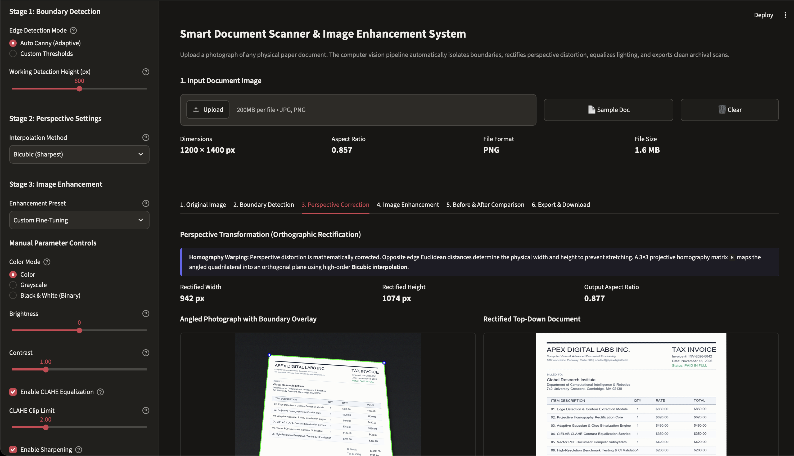
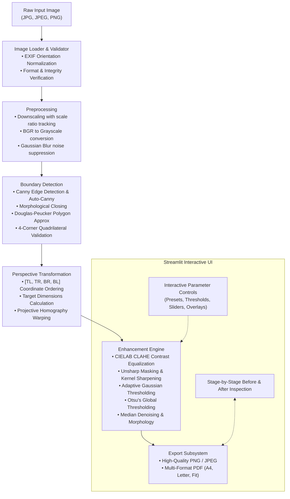

# Smart Document Scanner & Image Enhancement System

[](https://www.python.org/)
[](https://opencv.org/)
[](https://streamlit.io/)
[](https://python-poetry.org/)
[](https://pytest.org/)
[](LICENSE)

An intelligent, modular document scanning and image-enhancement system built from scratch in Python using traditional Computer Vision (OpenCV, NumPy, Pillow) and Streamlit. The application transforms ordinary photographs of physical documents into clean, sharp, perspective-corrected digital scans and exports them to JPEG, PNG, or multi-page searchable-ready PDFs.

---

## UI Glimpse



*DocScan Studio dashboard displaying the interactive 6-stage document processing workflow with real-time metadata cards, Canny edge detection, perspective homography rectification, and customizable image enhancement presets.*

---

## Table of Contents

- [UI Glimpse](#ui-glimpse)
- [Problem Statement](#problem-statement)
- [System Architecture](#system-architecture)
- [Core Features](#core-features)
- [Computer Vision Algorithms Explained](#computer-vision-algorithms-explained)
- [Project Structure](#project-structure)
- [Prerequisites](#prerequisites)
- [Installation Guide](#installation-guide)
  - [Option A: Using Poetry (Recommended)](#option-a-using-poetry-recommended)
  - [Option B: Using Standard Python Virtual Environment](#option-b-using-standard-python-virtual-environment)
- [How to Run the Application](#how-to-run-the-application)
- [Running Automated Tests](#running-automated-tests)
- [User Guide & Processing Workflow](#user-guide--processing-workflow)
- [Export Capabilities](#export-capabilities)
- [Software Engineering CV Summary](#software-engineering-cv-summary)
- [License](#license)

---

## Problem Statement

Capturing documents using mobile cameras introduces severe geometric and photographic degradation:
- **Perspective Distortion**: Angled capture causes non-uniform trapezoidal warping where parallel edges appear to converge.
- **Lighting & Shadows**: Ambient room lighting, uneven shadows from hands or phones, and flash glare create non-uniform background brightness.
- **Sensor Noise & Blur**: Lens imperfections, high ISO noise, and micro-movements blur text edges and introduce salt-and-pepper artifacts.
- **Halftone & Paper Bleed**: Text printed on paper often shows ink bleed-through or textured fiber patterns that impede OCR readability.

This system applies deterministic, classical computer vision methods—without the latency, unpredictability, or compute overhead of heavy neural networks—to detect boundaries, warp documents into true orthographic view, equalize lighting, sharpen text, and generate archival-quality black-and-white documents.

---

## System Architecture

The application adopts a decoupled pipeline architecture. Low-level vision algorithms remain completely isolated from the frontend presentation layer:



---

## Core Features

- **Robust Image Ingestion**:
  - Validates format, corruption, and minimum pixel thresholds.
  - Automatically handles mobile camera EXIF orientation tags (prevents 90°/180° rotation anomalies).
- **Automatic Boundary Detection**:
  - Edge and contour filtering with multi-constraint geometric quadrilateral verification.
  - Rejection of small false rectangular items (e.g., sticky notes, business cards, table edges).
  - Graceful fallback boundary ensures zero crashes on blank, low-contrast, or cluttered images.
- **Perspective Correction (Orthographic Rectification)**:
  - Canonical 4-corner coordinate ordering `[TL, TR, BR, BL]`.
  - High-precision homography matrix calculation and projective transformation with Bicubic interpolation.
- **Independent & Configurable Image Enhancement**:
  - **Adaptive Gaussian Thresholding**: Dynamically calculates per-pixel thresholds for crisp text extraction under gradient illumination and shadows.
  - **Otsu's Thresholding**: Bimodal histogram clustering for uniform studio lighting scans.
  - **CLAHE (Contrast Limited Adaptive Histogram Equalization)**: Operates strictly on the Lightness channel in CIELAB color space, eliminating shadows without color shifts.
  - **Median Filtering**: Eliminates salt-and-pepper sensor noise and paper speckles without blurring character strokes.
  - **Unsharp Masking & High-Pass Sharpening**: Boosts text legibility and edge gradients.
- **Interactive UI**:
  - Built with Streamlit with session state management.
  - Real-time parameter tuning with immediate 3-way before-and-after visual inspection.
- **Document Export**:
  - Direct download in PNG, JPEG (configurable quality), and vector-wrapped PDF (A4, Letter, Fit) formats.

---

## Computer Vision Algorithms Explained

### 1. Scaling Ratio Preservation
$$\text{ratio} = \frac{\text{original\_height}}{\text{downscaled\_height}}$$
High-resolution smartphone cameras capture images at 12–48 megapixels ($4032 \times 3024$). Performing edge and contour detection directly on such large matrices is computationally slow. We downsample the image to a working height (800px) with `cv2.INTER_AREA`. Once the 4 document corners are detected, each coordinate is multiplied by $\text{ratio}$ to warp the original full-resolution image without losing quality.

### 2. Douglas-Peucker Polygon Approximation
Uses recursive curve simplification:
$$\epsilon = k \times \text{perimeter}(\mathcal{C})$$
Contours representing paper boundaries often have micro-roughness. Polygon approximation simplifies the contour vertices within distance tolerance $\epsilon$. If the approximated polygon has exactly 4 vertices, is convex, and satisfies interior angle constraints ($45^\circ \le \theta \le 135^\circ$), it represents the document quadrilateral candidate.

### 3. Coordinate Ordering & Perspective Homography
The 4 detected points $[(x_1, y_1), \dots, (x_4, y_4)]$ are sorted into:
1. **Top-Left (TL)**: Smallest sum $(x + y)$.
2. **Bottom-Right (BR)**: Largest sum $(x + y)$.
3. **Top-Right (TR)**: Smallest difference $(y - x)$.
4. **Bottom-Left (BL)**: Largest difference $(y - x)$.

The target rectangular dimensions are calculated using Euclidean distance:
$$\text{width} = \max\left(\|\text{TR} - \text{TL}\|_2, \|\text{BR} - \text{BL}\|_2\right)$$
$$\text{height} = \max\left(\|\text{BL} - \text{TL}\|_2, \|\text{BR} - \text{TR}\|_2\right)$$

A $3 \times 3$ transformation matrix $M$ is solved via `cv2.getPerspectiveTransform()`, and the image is warped using projective mapping:
$$\begin{bmatrix} x' \\ y' \\ 1 \end{bmatrix} \sim M \begin{bmatrix} x \\ y \\ 1 \end{bmatrix}$$

### 4. Adaptive Gaussian Thresholding
Unlike global thresholding which fails under uneven illumination, adaptive thresholding computes a local threshold $T(x, y)$ for each pixel based on the Gaussian weighted average over a neighborhood block size $B$:
$$T(x, y) = \sum_{i,j \in \text{neighborhood}} G(i, j) \cdot I(x+i, y+j) - C$$
$$O(x, y) = \begin{cases} 255 & \text{if } I(x, y) > T(x, y) \\ 0 & \text{otherwise} \end{cases}$$

---

## Project Structure

```text
smart-document-scanner/
│
├── app.py                      # Streamlit web application entry point
├── pyproject.toml              # Poetry dependency & build specification
├── requirements.txt            # Flat dependency list for standard pip
├── README.md                   # Complete architectural and setup documentation
├── HOW_IT_WORKS.md             # Detailed technical pipeline and module guide
├── .gitignore                  # VCS ignore rules
│
├── public/                     # Static UI assets and documentation previews
│   └── user-interface.png      # Application dashboard interface screenshot
│
├── src/
│   ├── __init__.py
│   │
│   ├── preprocessing/          # Stage 1: Loading, EXIF transpose, resizing, blur
│   │   ├── __init__.py
│   │   ├── image_loader.py
│   │   ├── resize.py
│   │   └── filters.py
│   │
│   ├── detection/              # Stage 2: Canny, Auto-Canny, contours, 4-corner quad
│   │   ├── __init__.py
│   │   ├── edge_detection.py
│   │   ├── contour_detection.py
│   │   └── document_detection.py
│   │
│   ├── transformation/         # Stage 3: Corner ordering & perspective warping
│   │   ├── __init__.py
│   │   └── perspective.py
│   │
│   ├── enhancement/            # Stage 4: Thresholding, CLAHE, sharpening, denoising
│   │   ├── __init__.py
│   │   ├── grayscale.py
│   │   ├── thresholding.py
│   │   ├── denoising.py
│   │   ├── sharpening.py
│   │   ├── contrast.py
│   │   └── morphology.py
│   │
│   ├── export/                 # Stage 5: PNG, JPEG, and multi-page PDF generation
│   │   ├── __init__.py
│   │   ├── image_export.py
│   │   └── pdf_export.py
│   │
│   └── utils/                  # Helper utilities and validators
│       ├── __init__.py
│       └── validators.py
│
├── tests/                      # Automated pytest suite (48 tests)
│   ├── __init__.py
│   ├── test_preprocessing.py
│   ├── test_detection.py
│   ├── test_transformation.py
│   ├── test_enhancement.py
│   └── test_export.py
│
└── assets/
    └── sample_images/          # Sample document photographs and generator script
        ├── sample_document.png
        └── create_sample.py
```

---

## Prerequisites

- **Python**: Version `3.10`, `3.11`, `3.12`, `3.13`, or `3.14`
- **Operating System**: macOS, Linux, or Windows

---

## Installation Guide

### Option A: Using Poetry (Recommended)

1. Navigate to the project root:
   ```bash
   cd "Document Scanner"
   ```

2. Install all dependencies from lock file:
   ```bash
   poetry install
   ```

---

### Option B: Using Standard Python Virtual Environment

```bash
python3 -m venv .venv
source .venv/bin/activate  # On Windows: .venv\Scripts\activate
pip install --upgrade pip
pip install -r requirements.txt
```

---

## How to Run the Application

Start the Streamlit interactive dashboard:

```bash
# Using Poetry:
poetry run streamlit run app.py

# Or with activated venv:
streamlit run app.py
```

Access the UI at `http://localhost:8501`.

---

## Running Automated Tests

Run all 48 unit and edge-case tests with verbose output:

```bash
poetry run pytest -v
```

Output:
```text
tests/test_detection.py ......................... [ 29%]
tests/test_enhancement.py ...........            [ 50%]
tests/test_export.py ........                    [ 66%]
tests/test_preprocessing.py .........            [ 85%]
tests/test_transformation.py ........           [100%]

============================== 48 passed in 0.15s ==============================
```

---

## User Guide & Processing Workflow

1. **Input Document**: Upload any physical photograph (`.jpg`, `.jpeg`, `.png`) or click **"Sample Doc"** to load the bundled test photograph.
2. **Boundary Detection**: View the automatic green quadrilateral overlay. The system extracts Canny edges, applies morphological closing to seal broken edges, and fits an optimized 4-corner polygon.
3. **Perspective Correction**: The document is warped using a $3 \times 3$ projective matrix into an orthogonal, flat view.
4. **Enhancement**: Select from presets (**Adaptive B&W**, **Otsu B&W**, **Enhanced Grayscale**, **Sharpened Color**) or use **Custom Fine-Tuning** to adjust Brightness, Contrast, CLAHE clip limit, and Sharpening intensity.
5. **Before & After Inspection**: View a 3-way stage-by-stage comparison (Original vs Rectified vs Final Enhanced).
6. **Export**: Download as lossless PNG, configurable JPEG, or archival A4/Letter PDF.

---

## Export Capabilities

| Format | Output Size | Compression | Recommended Use Case |
| :--- | :--- | :--- | :--- |
| **PDF** | Standard A4 / Letter / Fit | Vector wrapped | Formal document sharing, printing, and archiving. |
| **PNG** | Native Rectified Resolution | Lossless DEFLATE | Archival storage preserving crisp character strokes. |
| **JPEG** | Native Rectified Resolution | Lossy (configurable 50-100%) | Email attachments and quick web previews. |

---

## License

This project is licensed under the MIT License.
